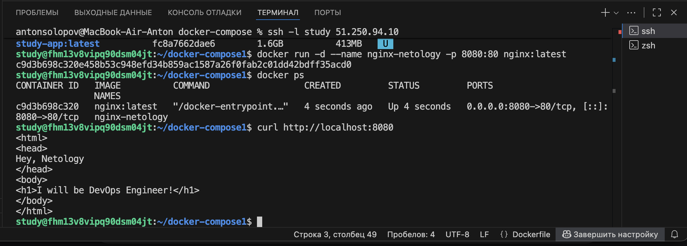
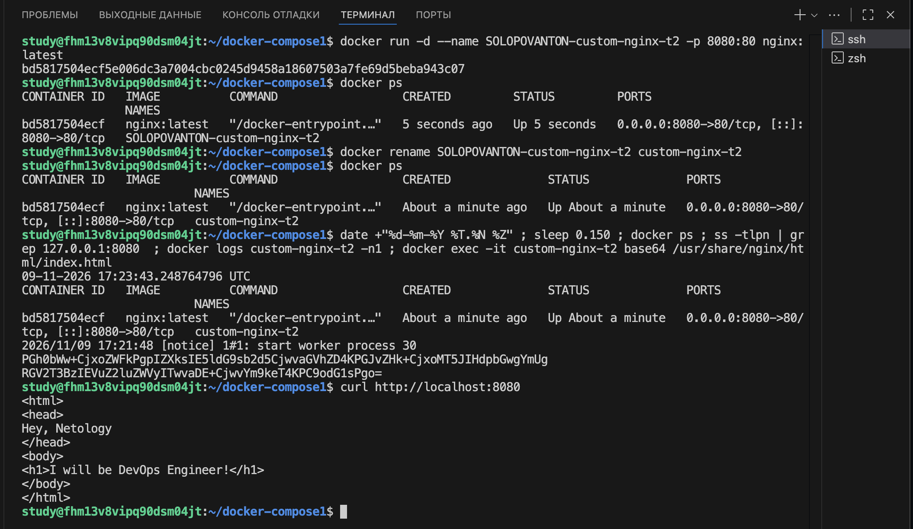
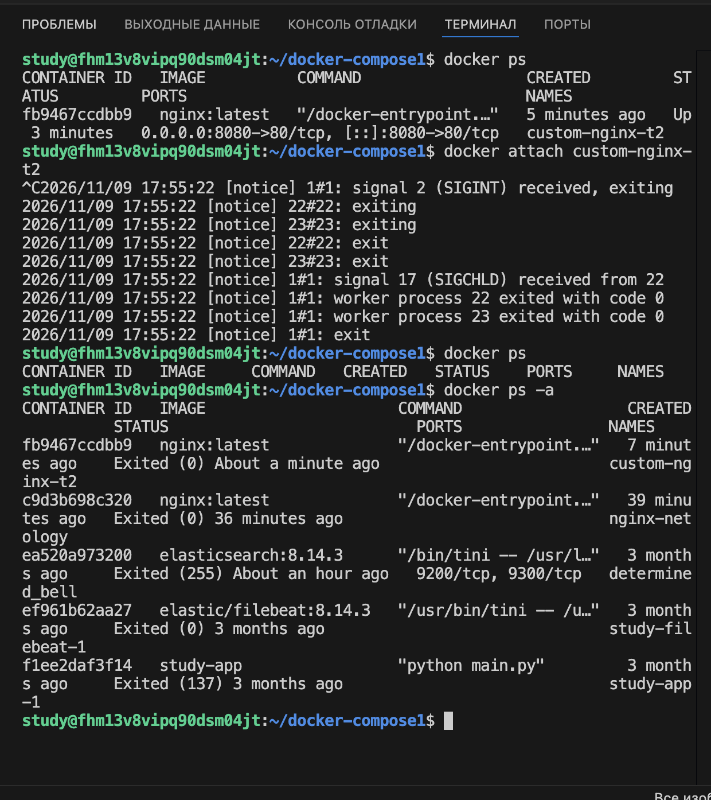
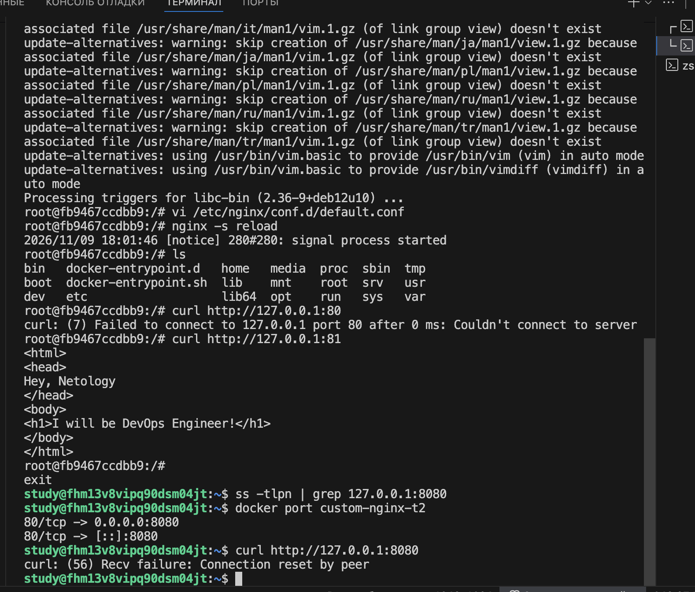
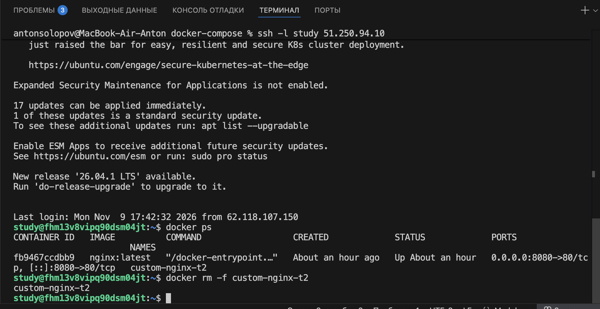
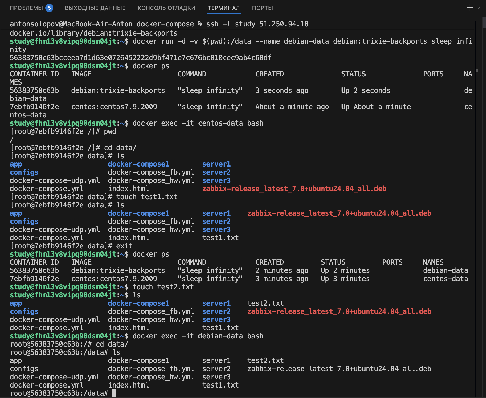
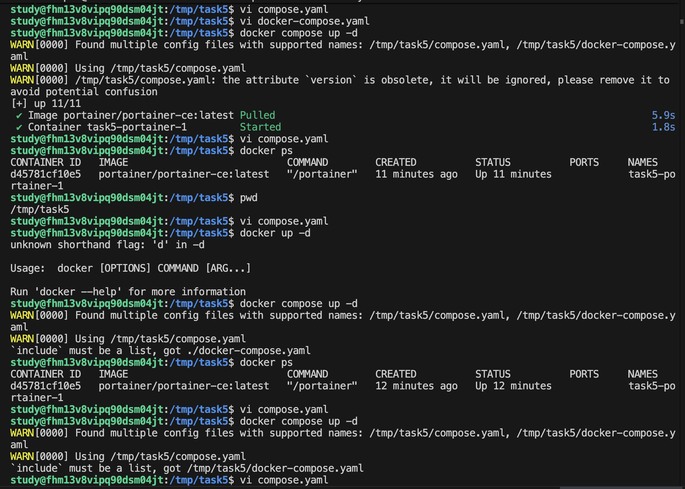
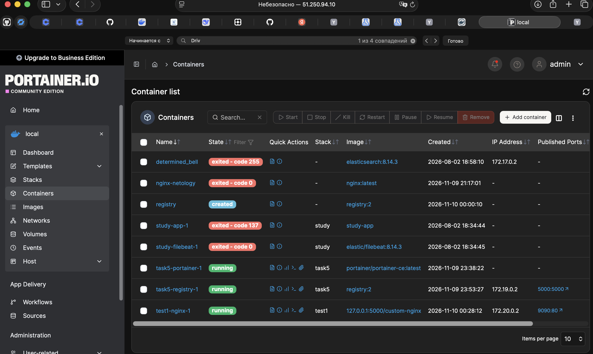
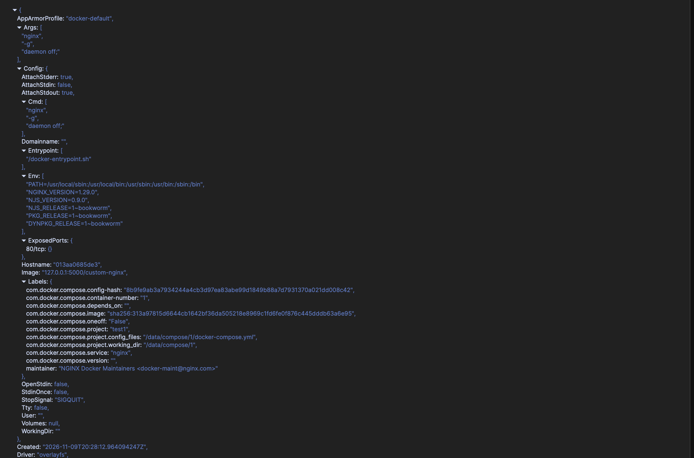
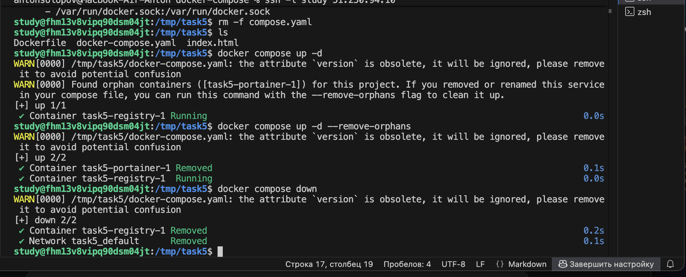

## 1. 

## 2. 

## 3. 
Нажатие Ctrl+C в терминале генерирует сигнал SIGINT, и Docker по умолчанию пересылает его основному процессу контейнера (PID 1) 

 Мы изменили в самом приложении слушающий порт. На хосте остался старый порт, при котором мы запускали контейнер. Правило проброса осталось которое мы указали , а вот приложение уже слушает другой порт, по этому возникнет ошибка при обращению к старому порту 80 
 

## 4. 

## 5. 
Файл был выбран compose.yaml - он выбирается по дефолту первый когда запускаешь docker compose up

Задеплоенный компоуз в портейнер

Конфиг

[Ссылка на compose.yaml](https://github.com/ultrmlvn/docker-compose/blob/main/compose.yaml)